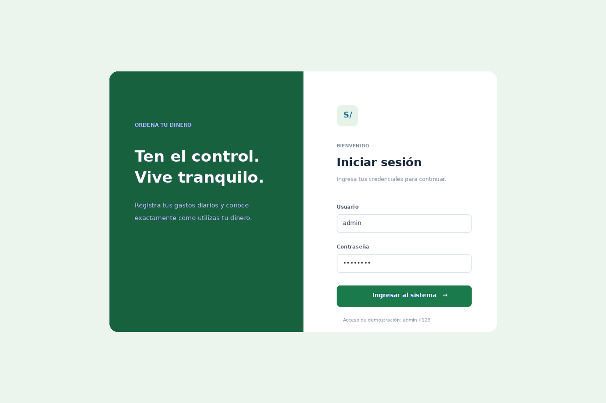
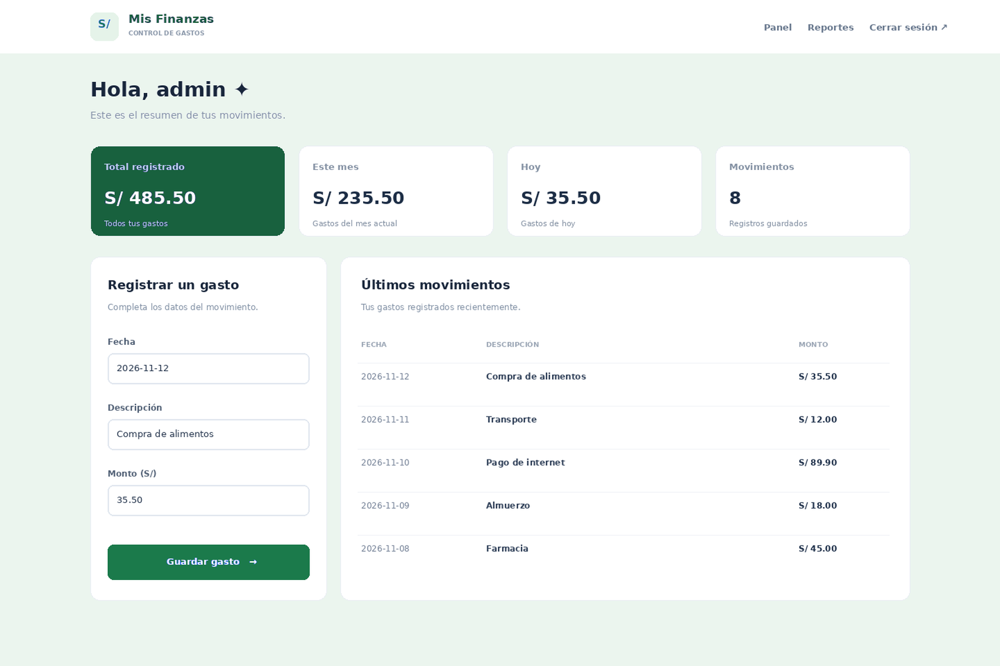
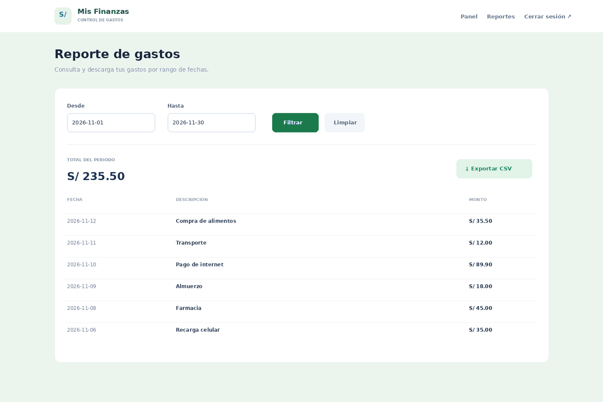

# 💰 MIS FINANZAS – Sistema de Control de Gastos

## 📌 Descripción del proyecto

MIS FINANZAS es una aplicación web desarrollada con Python, Flask y SQLite que permite administrar y controlar los gastos personales de manera sencilla, ordenada y eficiente.

El sistema permite registrar gastos, consultar el historial, visualizar resúmenes y generar reportes para facilitar el control de las finanzas personales.

## 🚀 Tecnologías utilizadas

- Python
- Flask
- SQLite
- HTML5
- CSS3
- Bootstrap

## 🔐 Credenciales de acceso

| Campo | Valor |
|---|---|
| Usuario | `admin` |
| Contraseña | `123` |

## ⚙️ Funcionalidades principales

1. Inicio de sesión mediante usuario y contraseña.
2. Registro de gastos con fecha, descripción y monto.
3. Visualización del historial de gastos.
4. Resumen general de gastos registrados.
5. Generación de reportes por fechas.
6. Eliminación de registros de gastos.
7. Exportación de información en formato CSV.
8. Almacenamiento de información mediante SQLite.

## 📸 Capturas de pantalla

### 1. Inicio de sesión



### 2. Panel principal



### 3. Reportes de gastos



## 💻 Instalación y ejecución

### Requisitos previos

- Tener instalado Python 3.
- Tener instalado Git (opcional).

### Pasos para ejecutar el proyecto

**1. Clonar el repositorio**

```bash
git clone https://github.com/rmendez-lang/control-gastos-flask.git
```

**2. Ingresar a la carpeta**

```bash
cd control-gastos-flask
```

**3. Crear el entorno virtual**

```bash
python -m venv venv
```

**4. Activar el entorno virtual en Windows**

```bash
venv\Scripts\activate
```

**5. Instalar las dependencias**

```bash
pip install -r requirements.txt
```

**6. Ejecutar la aplicación**

```bash
python app.py
```

**7. Abrir en el navegador**

```text
http://127.0.0.1:5000
```

## 🗄️ Base de datos

El sistema utiliza SQLite para almacenar los registros de gastos. La base de datos permite conservar la información registrada por el usuario.

## 📂 Estructura del proyecto

```text
control-gastos-flask/
│
├── app.py
├── requirements.txt
├── README.md
├── capturas/
│   ├── login.png
│   ├── dashboard.png
│   └── report.png
│
├── templates/
│
└── static/
```

## 👨‍💻 Autor

Proyecto académico desarrollado como práctica de programación web utilizando Python, Flask y SQLite.

## 🔗 Repositorio de GitHub

https://github.com/rmendez-lang/control-gastos-flask

---

**MIS FINANZAS – Controla tus gastos, organiza tu dinero y mejora tus finanzas.**
